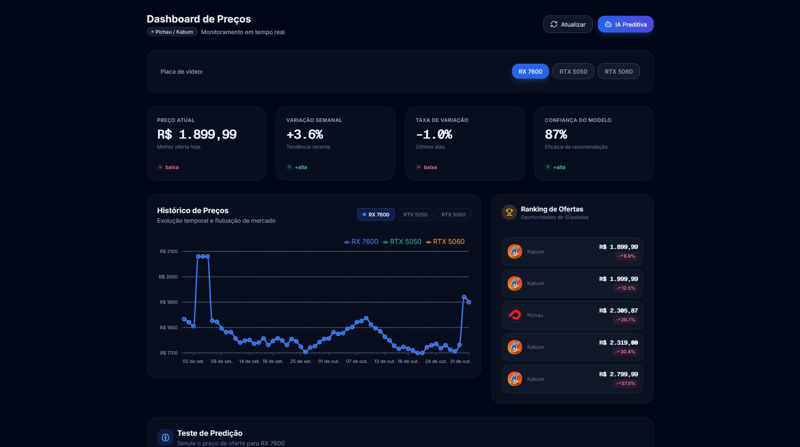

# Rastreador de Preços de GPUs — Pichau & Kabum

Sistema completo de rastreamento de preços de placas de vídeo (RX 7600, RTX 5050, RTX 5060) nas lojas **Pichau** e **Pichau Kabum**. O projeto coleta preços à vista via scraping, armazena no Supabase, treina um modelo de classificação com XGBoost para recomendar "Comprar Agora" ou "Aguardar Queda", e exibe os dados em um dashboard interativo.

<p align="center">
  
  <p><i>Dashboard com métricas, gráfico de tendência, ranking de ofertas e teste de predição em tempo real.</i></p>
</div>

---

## Tecnologias Utilizadas

| Camada | Tecnologia |
|--------|------------|
| **Backend** | FastAPI, Python 3.10, Uvicorn |
| **Machine Learning** | XGBoost (XGBClassifier), scikit-learn, joblib |
| **Banco de Dados** | Supabase (PostgreSQL) |
| **Scraping** | Playwright (Chromium headless), python-dotenv |
| **Frontend** | React 18, Vite, Tailwind CSS, Recharts, Lucide React |
| **Infraestrutura** | Docker, Kubernetes (Deployment, Service, CronJob) |

---

## Arquitetura do Sistema

O fluxo de dados segue quatro camadas principais:

1. **Scraper (Pichau & Kabum)** — Acessa os sites das lojas, extrai preços à vista via Playwright e insere em lote no Supabase. Roda como CronJob no Kubernetes (diário à meia-noite).
2. **Supabase (historico_precos)** — Armazena componente, loja, preço e data de registro.
3. **API FastAPI** — Carrega o modelo XGBoost treinado e expõe endpoints `/api/health` e `/api/predict`.
4. **Dashboard (React + Tailwind)** — Consome o Supabase para métricas e gráfico, e a API para simulações de predição em tempo real.

```text
┌─────────────┐      ┌──────────────────┐      ┌─────────────────┐
│  Scraper    │─────▶│   Supabase       │◀─────│   Frontend      │
│ (Playwright)│      │  (historico_precos)│      │  (React/Vite)   │
└─────────────┘      └──────────────────┘      └─────────────────┘
       │                      │                      │
       ▼                      ▼                      ▼
┌─────────────┐      ┌──────────────────┐      ┌─────────────────┐
│   Treino ML   │─────▶│  modelo.joblib   │◀─────│   API FastAPI   │
│  (XGBoost)    │      │     (joblib)     │      │  (/api/predict)   │
└─────────────┘      └──────────────────┘      └─────────────────┘
```

---

## Estrutura do Repositório

```
rastreador-precos/
├── README.md                         # Este arquivo
├── .env.example                      # Variáveis de ambiente (backend)
├── .dockerignore
├── Dockerfile                        # Imagem da API
├── requirements.txt                  # Dependências Python
├── api.py                            # FastAPI (endpoints /api/health, /api/predict)
├── scraper_pichau.py                 # Scraper Pichau + Kabum
├── treinar_modelo_precos.py          # Treinamento XGBoost com data augmentation
├── gerar_historico_precos.py         # Gerador de dados sintéticos retroativos
├── modelo_precos.joblib              # Modelo treinado (gerado pelo treino)
├── 1.png                             # Screenshot do dashboard
├── k8s/
│   ├── secret.yaml                   # Secrets do Supabase
│   ├── api-deployment.yaml           # Deployment da API (2 réplicas)
│   ├── api-service.yaml              # Service LoadBalancer (porta 80)
│   ├── scraper-cronjob.yaml          # CronJob diário (00:00 UTC)
│   └── README.md                     # Guia de implantação K8s
└── dashboard/                        # Frontend React + Tailwind
    ├── package.json
    ├── vite.config.js
    ├── tailwind.config.js
    ├── .env.example                  # Variáveis de ambiente (frontend)
    └── src/
        ├── App.jsx                   # Componente raiz com seletor de GPU
        ├── main.jsx                  # Entry point React
        ├── index.css                 # Estilos Tailwind
        ├── lib/supabase.js           # Cliente Supabase
        ├── utils/api.js              # Cliente da API FastAPI
        ├── utils/formatters.js       # Formatação de moeda/percentual
        └── components/
            ├── MetricCard.jsx        # Card de métrica com variação %
            ├── ChartPanel.jsx        # Gráfico de histórico (Recharts)
            ├── RankingPanel.jsx      # Ranking de ofertas
            ├── PredictionForm.jsx    # Formulário de predição IA
            └── ui/
                ├── Badge.jsx
                ├── Button.jsx
                ├── Card.jsx
                └── utils.js
```

---

## Execução Local

### Pré-requisitos
- Python 3.10+ com pip e venv
- Node.js 18+ com npm
- Conta no [Supabase](https://supabase.com) com tabela `historico_precos` criada

### 1. Backend (Python)

```bash
# Na raiz do projeto
cd rastreador-precos

# Criar e ativar ambiente virtual
python -m venv venv
# Windows:
venv\Scripts\Activate.ps1
# Linux/Mac:
source venv/bin/activate

# Instalar dependências
pip install -r requirements.txt
playwright install chromium

# Configurar variáveis de ambiente
cp .env.example .env
# Edite o .env com suas credenciais do Supabase

# Treinar o modelo
python treinar_modelo_precos.py

# Rodar a API
uvicorn api:app --host 0.0.0.0 --port 8000
```

### 2. Frontend (React)

```bash
# Na pasta do dashboard
cd dashboard
npm install

# Configurar variáveis de ambiente
cp .env.example .env
# Edite o .env com suas credenciais do Supabase

# Rodar em desenvolvimento
npm run dev -- --port 5173
```

Acesse `http://localhost:5173/`.

---

## Endpoints da API

| Método | Endpoint | Descrição |
|--------|----------|-----------|
| GET | `/api/health` | Verifica se a API está online |
| POST | `/api/predict` | Retorna recomendação do modelo (Comprar Agora / Aguardar Queda) |

Exemplo:

```bash
curl -X POST http://localhost:8000/api/predict \
  -H "Content-Type: application/json" \
  -d '{"preco": 2599.90, "media_movel_7d": 2700.00, "variacao_percentual": -5.0}'
```

Resposta:
```json
{"recomendacao": "Comprar Agora"}
```

---

## Variáveis de Ambiente

Crie um arquivo `.env` na raiz e `dashboard/.env` com base nos arquivos `.env.example`.

| Variável | Descrição | Exemplo |
|----------|-----------|---------|
| `SUPABASE_URL` | URL do projeto Supabase | `https://seu-projeto.supabase.co` |
| `SUPABASE_KEY` | Chave anon do Supabase | `sb_publishable_xxxxx` |
| `VITE_API_URL` | URL da API (frontend) | `http://localhost:8000/api` |
| `VITE_SUPABASE_URL` | URL do Supabase (frontend) | `https://seu-projeto.supabase.co` |
| `VITE_SUPABASE_ANON_KEY` | Chave anon do Supabase (frontend) | `sb_publishable_xxxxx` |

### Tabela no Supabase

```sql
CREATE TABLE IF NOT EXISTS public.historico_precos (
  id BIGINT GENERATED BY DEFAULT AS IDENTITY PRIMARY KEY,
  componente TEXT NOT NULL,
  loja TEXT NOT NULL,
  preco NUMERIC NOT NULL,
  data_registo TIMESTAMP WITH TIME ZONE DEFAULT NOW()
);

GRANT SELECT ON public.historico_precos TO anon;
```

---

## Segurança

- Não comite arquivos `.env`. Eles estão cobertos pelo `.gitignore`.
- Use apenas a chave `anon` do Supabase no frontend. Nunca exponha a `service_role`.
- Os segredos do Kubernetes (`k8s/secret.yaml`) devem ser preenchidos com valores reais antes de aplicar no cluster.

---

## Deploy com Kubernetes

```bash
cd k8s
kubectl apply -f secret.yaml
kubectl apply -f api-deployment.yaml
kubectl apply -f api-service.yaml
kubectl apply -f scraper-cronjob.yaml
```

Verifique a implantação:
```bash
kubectl get pods -l app=rastreador-api
kubectl get svc rastreador-api
kubectl get cronjob scraper-pichau
```

---

## Autor / Portfólio

**Nome:** Kaique  
**Função:** Engenheiro de Software / Cientista de Dados  
**LinkedIn:** [linkedin.com/in/kaique-nunes-vasconcelos-fraga-580867286](https://linkedin.com/in/kaique-nunes-vasconcelos-fraga-580867286)  
**GitHub:** [github.com/0110101101100001](https://github.com/0110101101100001)  
**E-mail:** kaiquenvf@gmail.com

---

## Licença

Este projeto está sob a licença MIT. Veja o arquivo `LICENSE` para mais detalhes.